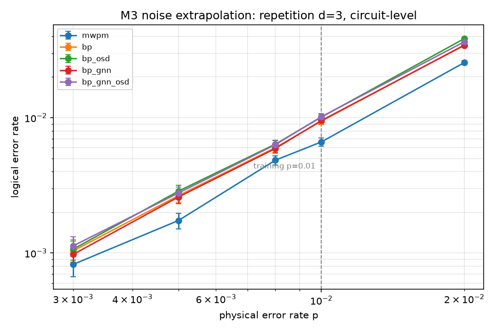
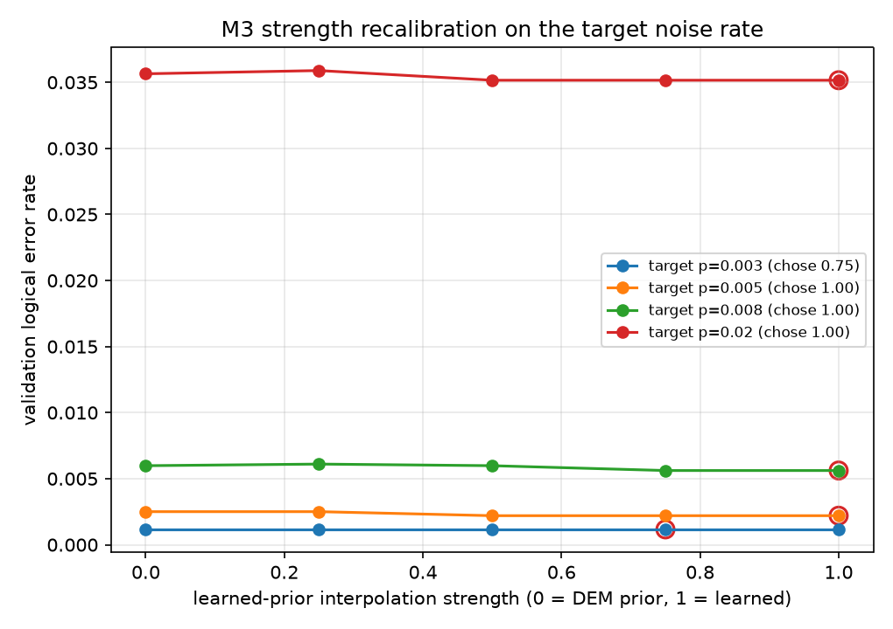
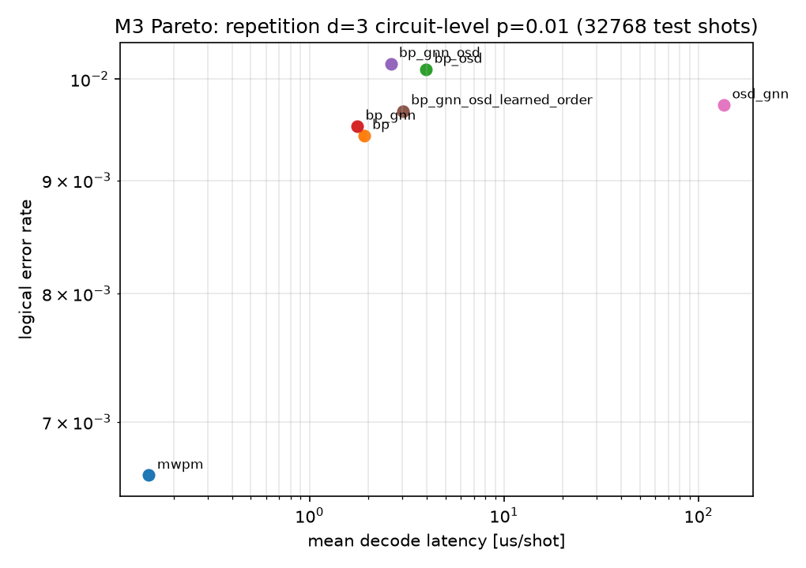

# M3：混合解码器（学习先验 + OSD 回退）与失效边界

日期：2026-10-13
前置：`docs/M2_GNN_REWEIGHTING.md`（M2 完成 GNN 边权重重估并接入 BP 先验）

## 1. 阶段目标

1. 把学习先验与 OSD-0 回退组合，检验「更低 LER + 100% syndrome 一致」是否可同时拿到；
2. 完成噪声外推（训练 p=0.01 → 测试 p≠0.01）与码距外推（训练 d=3 → 测试 d=5）；
3. 建立 LER–延迟 Pareto，并对 `bp_gnn` 与基线做配对检验；
4. 补齐 d=5 的同分布评测。

## 2. 解码器语义与代码结构

| 解码器 | 语义 |
|---|---|
| `bp` | 归一化 min-sum BP，先验取 DEM 概率 |
| `bp_osd` | BP 未收敛的 shot 走 OSD-0 |
| `bp_gnn` | 先验换成 GNN 学习的机制后验（插值强度 s） |
| `bp_gnn_osd` | `bp_gnn` + 未收敛 shot 走 OSD-0 |
| `bp_gnn_osd_learned_order` | 同 `bp_gnn_osd`，但 OSD 的候选排序改用学习 logits |
| `osd_gnn` | 强制全部 shot 走 OSD-0，排序用学习 logits |

| 文件 | 内容 |
|---|---|
| `src/graph_qec/m3_pipeline.py` | 加载 M2 checkpoint，在新分布（不同噪声率 / 噪声模型 / 码距）上评测，不重新训练 |
| `src/graph_qec/m3.py` | M3 迁移评测 CLI |
| `tests/test_m3_transfer.py` | 5 个测试：轴替换、跨噪声率迁移、跨码距迁移、checkpoint 架构不匹配报错、强度重标定 |
| `scripts/m3_failure_analysis.py` | 逐 shot 归因分析 + McNemar 检验 |
| `scripts/m3_osd_trigger_policy.py` | OSD-0 触发阈值扫描（LER–一致性 Pareto） |
| `scripts/m3_strength_recalibration.py` | 在目标分布验证集上重选先验插值强度 |
| `scripts/summarize_m3.py` / `scripts/plot_m3_results.py` | 汇总 `results/m3/SUMMARY.md`、`sweep.csv` 与 5 张图 |

## 3. 同分布结果（repetition d=3，circuit-level p=0.01，32768 test shots）

学习先验强度 s=1.00。

| decoder | logical errors | LER | s.e. | syndrome 一致 | 收敛率 | 平均迭代 | OSD 比例 | µs/shot |
|---|---:|---:|---:|---:|---:|---:|---:|---:|
| mwpm | 217 | **0.00662** | 0.00045 | - | - | - | - | 0.1 |
| bp | 309 | 0.00943 | 0.00053 | 0.9899 | 0.9899 | 0.707 | - | 1.9 |
| bp_osd | 331 | 0.01010 | 0.00055 | 1.0000 | 0.9899 | 0.707 | 0.0101 | 4.0 |
| bp_gnn | 312 | 0.00952 | 0.00054 | 0.9912 | 0.9912 | 0.557 | - | 1.8 |
| bp_gnn_osd | 333 | 0.01016 | 0.00055 | 1.0000 | 0.9912 | 0.557 | 0.0088 | 2.6 |
| bp_gnn_osd_learned_order | 317 | 0.00967 | 0.00054 | 1.0000 | 0.9912 | 0.557 | 0.0088 | 3.0 |
| osd_gnn | 319 | 0.00974 | 0.00054 | 1.0000 | 0.9899 | 0.707 | 1.0000 | 135.1 |

要点：

- MWPM 仍是最强基线（0.00662），BP 系最好为 0.00943；
- 学习先验在 d=3 上**没有显著收益**（`bp` 0.00943 vs `bp_gnn` 0.00952，McNemar z=-0.77，p=0.44），但平均迭代从 0.707 降到 0.557、收敛率从 0.9899 升到 0.9912；
- 学习 logits 用在 OSD 排序上有正收益（`bp_gnn_osd` 0.01016 vs `bp_gnn_osd_learned_order` 0.00967，z=+2.26，p=0.024），说明「逐机制边际适合做先验、不适合单独做候选基排序」这一分工在 OSD 排序层面有可用信息。

## 4. OSD-0 回退的一致性代价

学习先验下 99.12% 的 shot 在 BP 内收敛，288 个未收敛 shot 构成回退的全部作用域。

288 个未收敛 shot 上的逻辑错误数（`FAILURE_ANALYSIS.md`）：

| decoder | 子群内逻辑错误 |
|---|---:|
| bp | 147 |
| bp_gnn | 154 |
| bp_osd | 172 |
| bp_gnn_osd | 175 |
| bp_gnn_osd_learned_order | 159 |

OSD-0 在该子群内造成 155 次判定翻转：**67 修好 / 88 弄坏**，87 个仍然错误。

McNemar 配对检验（32768 shots）：

| 比较 | only A | only B | z | p（正态） | p（精确） |
|---|---:|---:|---:|---:|---:|
| `bp` vs `bp_gnn` | 6 | 9 | -0.77 | 0.439 | 0.607 |
| `bp_gnn` vs `bp_gnn_osd` | 67 | 88 | -1.69 | 0.0916 | 0.108 |
| `bp_osd` vs `bp_gnn_osd` | 16 | 18 | -0.34 | 0.732 | 0.864 |
| `bp_gnn_osd` vs `bp_gnn_osd_learned_order` | 33 | 17 | **+2.26** | 0.0237 | 0.0328 |

触发阈值扫描（`OSD_TRIGGER_POLICY.md`）给出了这段权衡的结构性原因：288 个未收敛 shot 的残余 syndrome 重量**全部等于 1**，因此

- 阈值 k=0 → OSD 作用于全部 288 shot：LER 0.01016，一致率 1.0000；
- 阈值 k≥1 → OSD 完全不触发：LER 0.00952，一致率 0.9912。

也就是说**不存在只救不伤的中间窗口**，可选的只有两端。这与 `bp_gnn_osd` 相对 `bp_gnn` 的负向（但统计上仅边缘显著）配对差异一致。


## 5. 噪声外推（d=3，训练 p=0.01，32768 shots）

测试 LER：

| physical_error_rate | shots | mwpm | bp | bp_osd | bp_gnn | bp_gnn_osd |
|---:|---:|---:|---:|---:|---:|---:|
| 0.003 | 32768 | 0.00082 | 0.00104 | 0.00107 | **0.00098** | 0.00113 |
| 0.005 | 32768 | 0.00174 | 0.00266 | 0.00287 | **0.00259** | 0.00278 |
| 0.008 | 32768 | 0.00485 | 0.00601 | 0.00638 | **0.00592** | 0.00632 |
| 0.02 | 32768 | **0.02554** | 0.03445 | 0.03839 | 0.03424 | 0.03638 |

syndrome 一致率：

| target | mwpm | bp | bp_osd | bp_gnn | bp_gnn_osd |
|---|---:|---:|---:|---:|---:|
| d3 p=0.003 | - | 0.9991 | 1.0000 | 0.9992 | 1.0000 |
| d3 p=0.005 | - | 0.9972 | 1.0000 | 0.9976 | 1.0000 |
| d3 p=0.008 | - | 0.9938 | 1.0000 | 0.9951 | 1.0000 |
| d3 p=0.02 | - | 0.9660 | 1.0000 | 0.9700 | 1.0000 |

机制后验在分布偏移下的校准（学习后验 vs DEM 先验）：

| target | shots | 学习 log loss | DEM log loss | 学习 AUC | DEM AUC | 机制准确率 |
|---|---:|---:|---:|---:|---:|---:|
| d3→d3 p=0.003 | 32768 | 0.00238 | 0.02966 | 0.9977 | 0.6280 | 0.9994 |
| d3→d3 p=0.005 | 32768 | 0.00511 | 0.04552 | 0.9952 | 0.6248 | 0.9989 |
| d3→d3 p=0.008 | 32768 | 0.00994 | 0.06665 | 0.9935 | 0.6192 | 0.9977 |
| d3→d3 p=0.02 | 32768 | 0.04900 | 0.13538 | 0.9730 | 0.6237 | 0.9864 |
| d3→d5 p=0.01 | 8192 | 0.02552 | 0.05231 | 0.9876 | 0.6585 | 0.9922 |

要点：跨噪声率上学习先验的 LER 收益很小但方向一致（4 个点均略优于 `bp`），机制层面则始终显著优于 DEM 先验（AUC 0.973-0.998 vs 0.62-0.66）。低噪声率区间 MWPM 仍全面领先。



## 6. 先验强度自标定

在目标分布的验证集上重选插值强度（`results/m3/recal_lowp/`、`recal_highp/`）：

| target p | 选中的强度 | bp LER | bp_gnn LER | bp_gnn_osd LER |
|---:|---:|---:|---:|---:|
| 0.003 | 0.75 | 0.00104 | 0.00098 | 0.00113 |
| 0.005 | 1.00 | 0.00266 | 0.00259 | 0.00278 |
| 0.008 | 1.00 | 0.00601 | 0.00592 | 0.00632 |
| 0.02 | 1.00 | 0.03445 | 0.03424 | 0.03638 |

验证集上的强度扫描曲线接近平坦，选出的最优强度为 0.75-1.00，说明在 d=3 上先验插值强度不是敏感超参数——这与第 3 节「d=3 收益本身很小」一致。强度自标定的真正价值在 d=5 及更大码距上体现（见第 7、8 节）。



## 7. 跨码距迁移（训练 d=3 → 测试 d=5，8192 shots）

| decoder | logical errors | LER | s.e. | syndrome 一致 | 收敛率 | 平均迭代 | µs/shot |
|---|---:|---:|---:|---:|---:|---:|---:|
| mwpm | 11 | **0.00134** | 0.00040 | - | - | - | 0.9 |
| bp | 416 | 0.05078 | 0.00243 | 0.8795 | 0.8795 | 5.467 | 336.7 |
| bp_osd | 516 | 0.06299 | 0.00268 | 1.0000 | 0.8795 | 5.467 | 416.0 |
| **bp_gnn** | **140** | **0.01709** | 0.00143 | 0.9634 | 0.9634 | 1.889 | 31.8 |
| bp_gnn_osd | 193 | 0.02356 | 0.00168 | 1.0000 | 0.9634 | 1.889 | 58.8 |

要点：d=3 训练的 GNN 直接用于 d=5，把 LER 从 0.05078 降到 0.01709（**-66%**），平均迭代 5.467 → 1.889，收敛率 0.8795 → 0.9634；机制后验 AUC 仍有 0.9876。OSD-0 回退在 d=5 上代价更大（0.01709 → 0.02356），因为 3.7% 的 shot 需要回退且这些 shot 的后验本身不可靠。

模型能读到输入的物理噪声率 p，因此这是**同一模型在新码距上的评测**，不是零样本迁移；去除 p 特征的真零样本迁移见 `docs/ROADMAP_TODO.md`（T12）。


## 8. d=5 同分布评测（d=5 checkpoint，4096 test shots）

| decoder | logical errors | LER | s.e. | syndrome 一致 | 收敛率 | 平均迭代 | µs/shot |
|---|---:|---:|---:|---:|---:|---:|---:|
| mwpm | 5 | **0.00122** | 0.00055 | - | - | - | 0.6 |
| bp | 194 | 0.04736 | 0.00332 | 0.8875 | 0.8875 | 5.241 | 70.8 |
| bp_osd | 243 | 0.05933 | 0.00369 | 1.0000 | 0.8875 | 5.241 | 133.3 |
| **bp_gnn** | **56** | **0.01367** | 0.00181 | 0.9692 | 0.9692 | 1.632 | 19.8 |
| bp_gnn_osd | 81 | 0.01978 | 0.00218 | 1.0000 | 0.9692 | 1.632 | 35.7 |

要点：d=5 上 `bp` 0.04736 → `bp_gnn` 0.01367（**-71%**），收敛率 0.8875 → 0.9692，单 shot 延迟 70.8 → 19.8 µs（收敛更快反而更快）。样本量 4096 shots（MWPM 仅 5 个错误），因此 `bp_gnn` 与 MWPM 的差距在该样本量下不具统计力，需要更大的 shot 数（见交付清单 T10）。

## 9. LER–延迟 Pareto

同一 headline 配置下（32768 shots）：

| decoder | LER | µs/shot |
|---|---:|---:|
| mwpm | 0.00662 | 0.1 |
| bp_gnn | 0.00952 | 1.8 |
| bp | 0.00943 | 1.9 |
| bp_gnn_osd | 0.01016 | 2.6 |
| bp_gnn_osd_learned_order | 0.00967 | 3.0 |
| bp_osd | 0.01010 | 4.0 |
| osd_gnn | 0.00974 | 135.1 |

学习先验把 BP 的延迟压到与基线相当或更低，但 d=3 上没有换来 LER 优势；`osd_gnn` 展示了纯 OSD 路径的延迟量级（135 µs/shot，约 70× 于 BP）。



## 10. 复现命令

```powershell
# 同分布 headline
.\.venv\Scripts\python.exe -m graph_qec.m2 `
  --config configs\m3_learned_basis_repetition_circuit_level_d3.json `
  --output-dir results\m3

# 迁移评测（噪声 / 码距）
.\.venv\Scripts\python.exe -m graph_qec.m3 `
  --config configs\m3_learned_basis_repetition_circuit_level_d3.json `
  --checkpoint results\m3\m3_learned_basis_repetition_circuit_level_d3__d3__circuit_level__p0p01\model_state.pt `
  --output-dir results\m3 --target-physical-error-rate 0.003 --decoders mwpm bp bp_osd bp_gnn bp_gnn_osd

# 失效归因 + McNemar
.\.venv\Scripts\python.exe scripts\m3_failure_analysis.py `
  --config configs\m3_learned_basis_repetition_circuit_level_d3.json `
  --checkpoint results\m3\m3_learned_basis_repetition_circuit_level_d3__d3__circuit_level__p0p01\model_state.pt

# 强度重标定
.\.venv\Scripts\python.exe scripts\m3_strength_recalibration.py `
  --config configs\m3_learned_basis_repetition_circuit_level_d3.json `
  --checkpoint results\m3\m3_learned_basis_repetition_circuit_level_d3__d3__circuit_level__p0p01\model_state.pt `
  --targets 0.003 0.005 0.008 0.02

# OSD 触发阈值扫描
.\.venv\Scripts\python.exe scripts\m3_osd_trigger_policy.py `
  --config configs\m3_learned_basis_repetition_circuit_level_d3.json `
  --checkpoint results\m3\m3_learned_basis_repetition_circuit_level_d3__d3__circuit_level__p0p01\model_state.pt

# 汇总与出图
.\.venv\Scripts\python.exe scripts\summarize_m3.py --results-dir results\m3
.\.venv\Scripts\python.exe scripts\plot_m3_results.py --results-dir results\m3
```

第 5、7、8 节的批量评测由 `scripts\run_m3_sweep.ps1` 并行启动，日志写入 `results/m3/logs/`。

## 11. 结论与失效边界

1. **d=3 repetition 上学习先验无显著收益**：`bp` 0.00943 vs `bp_gnn` 0.00952（z=-0.77，p=0.44），收益只在迭代次数与收敛率上体现；**2026-10-16 已补到 3 seeds / 98304 shots**：配对 ΔLER = +0.00009 / −0.00098 / +0.00003（均值 **−0.00028 ± 0.00035**，符号翻转），即「无收益」有误差棒支撑（`results/m2/HEADLINE_MULTISEED.md`）；
2. **一致性不免费**：OSD-0 在未收敛 shot 上 67 修好 / 88 弄坏，且触发阈值扫描显示 288 个未收敛 shot 的残余重量全为 1，不存在只救不伤的中间窗口；
3. **学习 logits 在 OSD 排序上有效**（z=+2.26，p=0.024），说明同一份逐机制边际在「排序」用途上有可用信息，但在「先验」用途上不足以在 d=3 上产生 LER 收益；
4. **跨码距迁移有效且在 BP 更弱的区间放大**：d=3 → d=5 为 -66%，d=5 自训练模型在其同分布上为 -71%；机制后验 AUC 0.9876；
5. **小码距下 MWPM 仍是最强基线**（d=3 0.00662、d=5 0.00122），BP 系解码器在 p ≤ 0.005 区间全面落后；
6. **工程约束**：d=5 的 BP 系延迟为 19.8-133.3 µs/shot（d=3 为 1.8-4.0 µs/shot），更大的码距需要向量化与批处理优化（见 `docs/BP_IMPLEMENTATION.md`）。

## 12. 未来工作

- **候选集学习**：把学习目标从逐机制边际改为候选基排序（OSD-λ / OSD-CS / learning-to-rank），见交付清单 T8；
- **真零样本迁移**：移除边特征中的 p，见 T12；
- **多噪声率训练课程**：见 T13；
- **表面码 d=5/d=7**：本机在 8192 shots 规模上可达，属于交付范围（T6），实测预算见 `docs/ROADMAP_TODO.md` 第 1 节。

---

## 附：T8 补充（2026-10-15）

本节结论 2「OSD-0 回退换不来免费的 syndrome 一致」在 T8 中得到了**正面出口**：把候选基从「OSD-0 的固定 pivot 基」换成 **OSD-CS(λ)** 的组合扫描后，同一批未收敛 shot 上回退从「弄坏」变成「修好」——

- 同一 288 个未收敛 shot：`bp_gnn` 154 错 → OSD-0 175 错（-21 净损失）→ OSD-CS(4) **91 错**（净改进 63，MWPM 参考 83）；
- 全测试集（32768 shots）：`bp` 0.00943 → `bp_osd_cs4` **0.00754**（McNemar z=5.03，p<1e-6）。

即：**瓶颈从来不是「OSD 该不该开」，而是「候选基选得对不对」。** 详见 `docs/T8_OSD_CANDIDATE_SET.md`。
