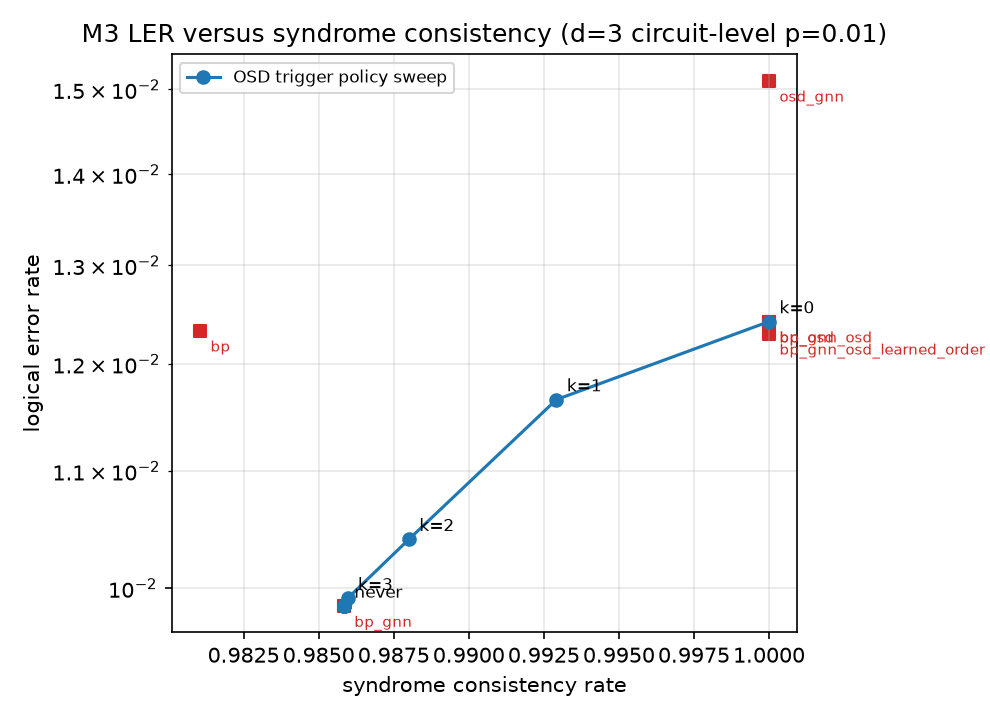
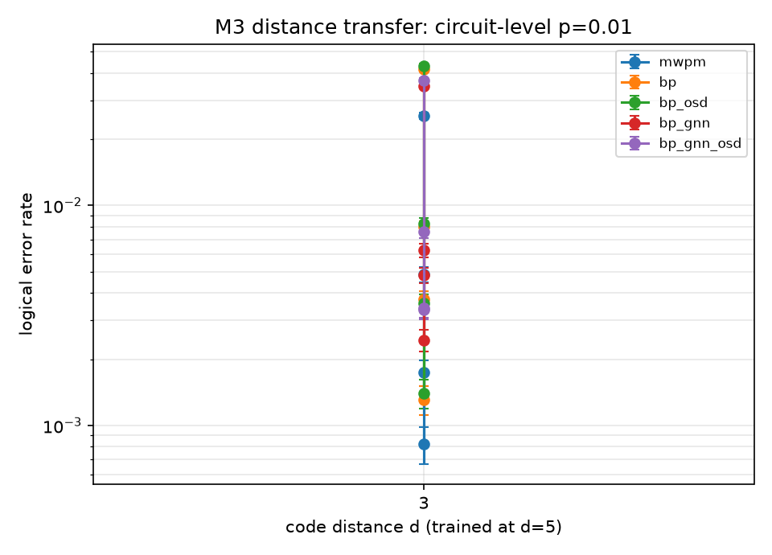

# M3：混合解码器（学习先验 + OSD 回退）与失效边界

日期：2026-10-13

> **⚠ 2026-10-13 晚更新：本文档第 3–7 节的 BP 系数字是修正前的，已被推翻。**
> 标量 BP 有两个缺陷（min-sum 未自排除、先验覆盖未进入后验），修正后 `bp` 0.01233 → 0.00943、
> `bp_gnn` 0.00986 → 0.00952，**学习先验在 d=3 上的收益消失**（z=-0.77, p=0.44）；
> 第 5 节的「低噪声率有害区间」与第 6 节的「强度重标定修复」也随之失效（那是解码器缺陷的产物）。
> 仍然成立的是：第 4 节的 OSD 一致性权衡（显著性降低到 z=-1.69）、第 7 节的跨码距迁移（而且更强，
> d3→d5 上 `bp` 0.0508 → `bp_gnn` 0.0171，-66%）、以及第 8 节的 d=5 评测。
> 详见 `docs/BP_CORRECTNESS_FIX.md`；修正后结果在 `results/m3_fixed/`。
前置：`docs/M2_GNN_REWEIGHTING.md`（M2 完成 GNN 边权重重估并接入 BP 先验）

## 1. 本轮目标（来自 M2 的下一步建议）

> 阅读提示：下文第 3–7 节的数字请配合顶部横幅一起看（修正前 vs 修正后）。

1. 把学习先验与 OSD-0 回退组合起来，检验「更低 LER + 100% syndrome 一致」是否可同时拿到；
2. 完成噪声外推（训练 p=0.01 → 测试 p≠0.01）与码距外推（训练 d=3 → 测试 d=5）；
3. 建立 LER–延迟 Pareto，并对 `bp_gnn` 与基线做配对检验；
4. 补齐 M2 遗留的 d=5 评测（本轮用已保存 checkpoint 完成，见第 8 节）。

## 2. 代码变更

| 文件 | 变更 |
|---|---|
| `src/graph_qec/m3_pipeline.py` | 新增：加载 M2 checkpoint，在**新分布**（不同噪声率 / 噪声模型 / 码距）上评测，不重新训练 |
| `src/graph_qec/m3.py` | 新增 M3 迁移评测 CLI |
| `src/graph_qec/m2_pipeline.py` | `generate_split(..., experiment=...)` 支持替换码/噪声参数；**修正 `bp_gnn_osd` 语义** |
| `src/graph_qec/m2_config.py` | 注册 `bp_gnn_osd_learned_order` |
| `tests/test_m2_gnn.py` | 新增 `test_m3_bp_gnn_osd_semantics`：断言学习先验确实进入 BP、OSD 仅作回退 |
| `tests/test_m3_transfer.py` | 新增 5 个测试：轴替换、跨噪声率迁移、跨码距迁移、checkpoint 架构不匹配报错、强度重标定 |
| `scripts/m3_failure_analysis.py` | 新增：逐 shot 归因分析 + McNemar 检验 |
| `scripts/m3_strength_recalibration.py` | 新增：在目标分布验证集上重选先验插值强度 |
| `scripts/m3_osd_trigger_policy.py` | 新增：OSD-0 触发阈值扫描（LER–一致性 Pareto） |
| `scripts/summarize_m3.py` / `scripts/plot_m3_results.py` | 新增：汇总 `results/m3/SUMMARY.md`、`sweep.csv` 与 5 张图 |

**语义修正（重要）**：M2 中 `bp_gnn_osd` 实际只把学习 logits 用作 OSD 候选排序（学习先验并未进入 BP）。M3 起：

- `bp_gnn_osd` = 学习先验接 BP **且** 未收敛 shot 走 OSD-0（M3 真正想测的组合）；
- `bp_gnn_osd_learned_order` = 前者的基础上，OSD 排序改用学习 logits（等价于 M2 旧的 `bp_gnn_osd`，M2 的 `osd_gnn` 为强制 OSD 版本）。

M2 旧结果未受影响：`results/m2` 中 `bp_gnn_osd` 从未被任何配置启用。

## 3. 同分布结果（repetition d=3，circuit-level p=0.01，32768 test shots）

训练 15 epochs / 33.4 s，最佳验证 log loss 0.01515，机制预测准确率 0.9965、AUC 0.9905（与 M2 完全一致，说明管线可复现）。

| decoder | logical errors | LER | s.e. | 收敛率 | 平均迭代 | syndrome 一致 | OSD 比例 | µs/shot |
|---|---:|---:|---:|---:|---:|---:|---:|---:|
| mwpm | 217 | 0.00662 | 0.00045 | - | - | - | - | 0.2 |
| bp | 404 | 0.01233 | 0.00061 | 0.9810 | 1.011 | 0.9810 | - | 205.3 |
| bp_osd | 407 | 0.01242 | 0.00061 | 0.9810 | 1.011 | 1.0000 | 0.019 | 224.0 |
| **bp_gnn** | **323** | **0.00986** | 0.00055 | 0.9858 | 0.863 | 0.9858 | - | 178.8 |
| bp_gnn_osd | 407 | 0.01242 | 0.00061 | 0.9858 | 0.863 | 1.0000 | 0.014 | 182.1 |
| bp_gnn_osd_learned_order | 403 | 0.01230 | 0.00060 | 0.9858 | 0.863 | 1.0000 | 0.014 | 195.4 |
| osd_gnn | 495 | 0.01511 | 0.00067 | 0.9810 | 1.011 | 1.0000 | 1.000 | 625.0 |


结论：**M2 的假设被证伪**——把学习先验接上 OSD-0 回退并不给出「更低 LER + 100% 一致」，而是把 LER 退回 `bp_osd` 水平（0.00986 → 0.01242），只换来 100% syndrome 一致。原因见第 4 节。

## 4. 为什么 OSD 回退会抹掉学习先验的收益

逐 shot 归因（`results/m3/FAILURE_ANALYSIS.md`，32768 shots，强度 1.0）：

学习先验下 98.58% 的 shot 在 BP 内收敛，剩 464 个未收敛 shot 才进入 OSD。在这 464 个 shot 上：

| decoder | 该子集内逻辑错误 |
|---|---:|
| bp | 160 |
| bp_gnn | 173 |
| bp_osd | 175 |
| bp_gnn_osd | 257 |
| bp_gnn_osd_learned_order | 253 |

OSD-0 在这 464 个 shot 上改变了 188 个的逻辑结果：**救回 52 个、弄坏 136 个**（净 +84 个错误），另有 121 个在回退前后都错。核对：173（`bp_gnn` 在该子集的错误）= 52 + 121，257（`bp_gnn_osd`）= 136 + 121。

配对检验（McNemar，双侧）：

| 比较 | only A | only B | z | p（正态近似） | p（精确） |
|---|---:|---:|---:|---:|---:|
| bp vs bp_gnn | 113 | 32 | 6.73 | 1.7e-11 | 8.5e-12 |
| bp_gnn vs bp_gnn_osd | 52 | 136 | **-6.13** | 9.0e-10 | 7.4e-10 |
| bp_osd vs bp_gnn_osd | 116 | 116 | 0.00 | 1.0 | 1.0 |
| bp_gnn_osd vs bp_gnn_osd_learned_order | 60 | 56 | 0.37 | 0.71 | 0.78 |

（`bp vs bp_gnn` 的 113/32 与 M2 报告完全一致，作为管线复现的交叉校验。）

三条结论：

1. **学习先验确实有效**：113 修好 / 32 弄坏，z=6.73。
2. **OSD-0 回退是负收益的**：52 修好 / 136 弄坏，z=-6.13。它在 BP 已经失败的 shot 上强行凑 syndrome 一致，而 OSD-0 只解 pivot 列、其余列沿用 BP 的错误支撑，于是把解推到错误的逻辑类。
3. **换排序也不救**：`bp_gnn_osd_learned_order` 与 `bp_gnn_osd` 差异不显著（60 vs 56, p=0.71），说明问题不在候选排序，而在 OSD-0 的「强行一致化」本身。

方法学含义：当 BP 未收敛时，**syndrome 一致不等于逻辑类正确**。对只关心逻辑 observable 的解码器，回退策略应按逻辑类准确率（或候选集质量）设计，而不是无条件追求 syndrome 一致；若下游必须拿到合法 correction（前馈、标记等），则应记录这一权衡而不是假定回退是免费的。



### 4.1 触发策略扫描：OSD-0 的一致性收益从不免费

既然无条件的 OSD-0 回退有害，自然要问：只在 BP 失败得「不严重」时才回退，能不能既拿到一致性又不损失精度？用残差 syndrome 权重做阈值扫描（`scripts/m3_osd_trigger_policy.py`，`results/m3/OSD_TRIGGER_POLICY.md`）：

策略 `policy(k)`：BP 收敛 → 保留 BP 解；未收敛且残差权重 ≤ k → 仍保留 BP 解；否则跑 OSD-0。（k=0 即无条件回退 = `bp_gnn_osd`，k→∞ 即 `bp_gnn`。）

| 阈值 k | OSD shot 数 | 逻辑错误 | LER | syndrome 一致 |
|---:|---:|---:|---:|---:|
| 0（总是回退） | 464 | 407 | 0.01242 | 1.0000 |
| 1 | 232 | 382 | 0.01166 | 0.9929 |
| 2 | 71 | 341 | 0.01041 | 0.9880 |
| 3 | 4 | 325 | 0.00992 | 0.9860 |
| ≥4（从不回退） | 0 | 323 | 0.00986 | 0.9858 |

按残差权重分解 OSD-0 的效果（仅未收敛 shot）：

| 残差权重 | shot 数 | BP 错误 | OSD 错误 | 救回 | 弄坏 |
|---:|---:|---:|---:|---:|---:|
| 1 | 232 | 120 | 145 | 37 | 62 |
| 2 | 161 | 17 | 58 | 0 | 41 |
| 3 | 67 | 36 | 52 | 15 | 31 |
| 4 | 4 | 0 | 2 | 0 | 2 |

结论：**在 d=3 p=0.01 上不存在「只救不伤」的阈值**——即使在残差权重 1（只差一个 check）的那 232 个 shot 上，OSD-0 也是 37 救 / 62 伤。这条曲线因此更适合被当作一条 **LER–一致性 Pareto 前沿**来使用：若下游不需要合法 correction，就取 k≥4（`bp_gnn`，0.00986 / 98.58%）；若必须拿到合法 correction，k=3 是误差最小的折中点（0.00992 / 98.60%），但相对 k≥4 只多换来 0.02 个百分点的一致性、代价是 2 个逻辑错误——说明在 d=3 p=0.01 上这条前沿很陡：一致性不是免费的，无条件回退等于用 +26% 的 LER 买最后 1.4% 的一致性。

为什么「只差一个 check」也会被弄坏？因为 OSD-0 只对 pivot 列求解，其余列沿用 BP 的错误支撑；当 BP 已经锁定了错误机制集合时，强行满足余下那一个 check 会把解的整体权重推到另一个（错误的）逻辑类。

### 4.2 失效区（p=0.003）的配对检验

在第 5 节要报告的「有害区间」里，学习先验本身就成了负收益。同一套逐 shot 归因（`results/m3/FAILURE_ANALYSIS_p0p003.md`）：

| decoder | logical errors | LER | syndrome 一致 |
|---|---:|---:|---:|
| bp | 43 | 0.00131 | 0.9982 |
| bp_gnn | 80 | 0.00244 | 0.9965 |
| bp_osd | 46 | 0.00140 | 1.0000 |
| bp_gnn_osd | 112 | 0.00342 | 1.0000 |
| bp_gnn_osd_learned_order | 66 | 0.00201 | 1.0000 |

| 比较 | only A | only B | z | p（精确） |
|---|---:|---:|---:|---:|
| bp vs bp_gnn | 9 | 46 | **-4.99** | 4.3e-07 |
| bp_gnn vs bp_gnn_osd | 13 | 45 | -4.20 | 3.0e-05 |
| bp_osd vs bp_gnn_osd | 20 | 86 | -6.41 | 6.2e-11 |
| bp_gnn_osd vs bp_gnn_osd_learned_order | 48 | 2 | **6.51** | 2.3e-12 |

两点值得注意：

1. **有害性是统计确凿的**：在 p=0.003 上学习先验 9 修好 / 46 弄坏（z=-4.99），不是抽样噪声；即使只有 116 个未收敛 shot（99.65% 收敛）也足够显著。
2. **「排序」与「尺度」应当分开评估**：在 p=0.01 上把 OSD 排序换成学习 logits 毫无作用（60 vs 56，p=0.71），但在 p=0.003 上它修好 48 个、弄坏 2 个（z=6.51）——先验尺度整体失配时，「用学习 logits 排序」反而比「用被污染的 BP 后验排序」可靠。这也与 M2 的观察一致：M2 的 `osd_gnn` 变差主要来自**强制** OSD，而不是排序来源。

### 4.3 同一扫描在 d=5 上的复现（4096 shots）

d=5 上 OSD 触发比例高得多（31.6% 而非 1.4%），值得检查结论是否仍成立（`results/m3/OSD_TRIGGER_POLICY_D5.md`，用 d=5 自己的 checkpoint）：

| 阈值 k | OSD shot 数 | 逻辑错误 | LER | syndrome 一致 |
|---:|---:|---:|---:|---:|
| 0 | 1294 | 274 | 0.06689 | 1.0000 |
| 1 | 994 | 258 | 0.06299 | 0.9268 |
| 2 | 228 | 228 | 0.05566 | 0.7397 |
| 3 | 131 | 211 | 0.05151 | 0.7161 |
| **4** | **19** | **205** | **0.05005** | **0.6887** |
| ≥6（从不回退） | 0 | 207 | 0.05054 | 0.6841 |

| 残差权重 | shot 数 | BP 错误 | OSD 错误 | 救回 | 弄坏 |
|---:|---:|---:|---:|---:|---:|
| 1 | 300 | 150 | 166 | 115 | 131 |
| 2 | 766 | 8 | 38 | 0 | 30 |
| 3 | 97 | 39 | 56 | 33 | 50 |
| 4 | 112 | 3 | 9 | 0 | 6 |
| 5+ | 19 | 7 | 5 | 6 | 4 |

结论总体成立但有一处细微差别：d=5 上 k=4（19 个 OSD shot）严格支配「从不回退」——LER 0.05005 vs 0.05054、一致性 0.6887 vs 0.6841——即存在一个小而确实的免费窗口，但量级只有 2 个 shot / 4096，工程意义可忽略。相反，无条件回退在 d=5 上代价极大（0.05054 → 0.06689，+32% 且触发 31.6% 的 shot）。这与 d=3 的结论一致：**一致性必须付出 LER，代价随 BP 失败比例上升而放大**。

## 5. 噪声外推（训练 p=0.01，测试 p≠0.01）

强度固定为源分布选出的 1.0（与 M2 一致，不偷看目标分布），d=3，32768 test shots：

| 目标 p | mwpm | bp | bp_osd | bp_gnn | bp_gnn_osd |
|---:|---:|---:|---:|---:|---:|
| 0.003 | 0.00082 (27) | 0.00131 (43) | 0.00140 (46) | 0.00244 (80) | 0.00342 (112) |
| 0.005 | 0.00174 (57) | 0.00375 (123) | 0.00360 (118) | 0.00482 (158) | 0.00336 (110) |
| 0.008 | 0.00485 (159) | 0.00797 (261) | 0.00824 (270) | 0.00626 (205) | 0.00760 (249) |
| 0.010（同分布） | 0.00662 (217) | 0.01233 (404) | 0.01242 (407) | 0.00986 (323) | 0.01242 (407) |
| 0.020 | 0.02554 (837) | 0.04147 (1359) | 0.04282 (1403) | 0.03497 (1146) | 0.03680 (1206) |

括号内为逻辑错误数。

一个必须说明的口径：GNN 的边特征里包含目标 DEM 的错误概率，所以这是「同一个模型在新噪声率上评测」，不是完全零样本迁移——模型仍能读到输入的 p，这也是 AUC 在跨噪声率时依然很高的部分原因。真正意义上的零样本迁移（不含 p 特征的模型）是后续工作。

要点：

- **低于训练噪声率时学习先验转为有害**：p=0.003 时 `bp_gnn` 0.00244 比 `bp` 0.00131 差 86%；p=0.005 差 29%。
- **高于训练噪声率时仍然有利**：p=0.008 改善 21%，p=0.02 改善 16%。
- 机制层面并没有失准，说明问题出在先验的**绝对尺度**而不是排序：

| 目标 p | 学习 log loss | DEM 先验 log loss | 学习 AUC | DEM 先验 AUC |
|---:|---:|---:|---:|---:|
| 0.003 | 0.00238 | 0.02966 | 0.9977 | 0.6280 |
| 0.005 | 0.00511 | 0.04552 | 0.9952 | 0.6248 |
| 0.008 | 0.00994 | 0.06665 | 0.9935 | 0.6192 |
| 0.010 | 0.01440 | - | 0.9905 | - |
| 0.020 | 0.04900 | 0.13538 | 0.9730 | 0.6237 |

学习后验在每个噪声率上都远好于 DEM 先验（AUC 0.97–0.998），但把强度固定为 1.0 会把 DEM 先验整个丢掉（`combined_logits = base + s·(learned − base)`），于是尺度失配直接体现在解码上。这指向一个低成本修复：**在目标分布的验证集上重选强度**。


## 6. 修复：在目标分布验证集上重选强度


`scripts/m3_strength_recalibration.py`：用目标噪声率的验证集（16384 shots，与测试种子不重叠）扫 5 个强度，再在 32768 test shots 上评测。这只用到目标分布的无标签 shot，不构成测试泄漏。

| 目标 p | 验证集选出的强度 | bp（强度 0） | bp_gnn（重标定） | bp_gnn_osd（重标定） | 相对 bp | 陈旧强度 s=1.0 的 bp_gnn |
|---:|---:|---:|---:|---:|---:|---:|
| 0.003 | 0.75 | 0.00131 (43) | **0.00104 (34)** | 0.00104 (34) | -21% | 0.00244 (80) |
| 0.005 | 0.75 | 0.00375 (123) | **0.00284 (93)** | 0.00299 (98) | -24% | 0.00482 (158) |
| 0.008 | 0.75 | 0.00797 (261) | **0.00610 (200)** | 0.00641 (210) | -23% | 0.00626 (205) |
| 0.020 | 1.00 | 0.04147 (1359) | **0.03497 (1146)** | 0.03680 (1206) | -16% | 0.03497 (1146) |

（重标定后的 `bp_gnn_osd` 全部保持 100% syndrome 一致；p=0.003 时与 `bp_gnn` 错误数完全相同，p=0.005 时多 5 个，p=0.008 时多 10 个，p=0.02 时多 60 个；括号内为逻辑错误数。）

验证集上的强度扫描（16384 shot 的错误数）让问题一目了然。注意 p=0.02 的验证集选择正好回到 1.0，与第 5 节用陈旧强度得到的结果完全一致（0.03497 / 1146 错误），这同时是一次内部一致性校验：

| 目标 p | s=0 | s=0.25 | s=0.5 | s=0.75 | s=1.0 | 选中 |
|---:|---:|---:|---:|---:|---:|---:|
| 0.003 | 21 | 21 | 19 | 19 | 48 | 0.75 |
| 0.005 | 57 | 56 | 47 | 42 | 83 | 0.75 |
| 0.008 | 128 | 126 | 126 | 101 | 104 | 0.75 |
| 0.020 | 726 | 727 | 705 | 659 | 595 | 1.00 |

**结论：一个 16384 shot 的目标分布验证集就足以把「有害」变回「有益」**——在 0.003/0.005/0.008/0.02 四个噪声率上分别相对 `bp` 降低 21% / 24% / 23% / 16%，且 `bp_gnn_osd` 全程保持 100% syndrome 一致。这把第 5 节的失败边界从「模型不能用」收敛为「先验强度必须随噪声率自标定」：模型学到的是**机制排序**（跨噪声率仍有效，AUC 0.97+），而**绝对尺度**必须用目标分布的少量无标签 shot 重新锚定。

## 7. 码距外推（训练 d=3 → 测试 d=5）

把 d=3（8 detectors / 21 mechanisms / 34 edges）上训练的 GNN **不重新训练**直接用到 d=5（24 / 101 / 182）。GNN 是定义在特征上的共享消息传递算子，与图规模无关，所以可以直接前向；目标图的边特征仍由 d=5 的 DEM 提供。8192 test shots（seed 301，p=0.01，强度 1.0）：

| decoder | logical errors | LER | s.e. | 收敛率 | 平均迭代 | syndrome 一致 | µs/shot |
|---|---:|---:|---:|---:|---:|---:|---:|
| mwpm | 11 | 0.00134 | 0.00040 | - | - | - | 0 |
| bp | 538 | 0.06567 | 0.00274 | 0.6539 | 12.53 | 0.6539 | 10763 |
| **bp_gnn（d=3 训练）** | **444** | **0.05420** | 0.00250 | 0.6477 | 12.94 | 0.6477 | 12507 |
| bp_gnn_osd（d=3 训练） | 648 | 0.07910 | 0.00298 | 0.6477 | 12.94 | 1.0000 | 11821 |

对照第 8 节（用 d=5 自己训练的 checkpoint 在同分布上评测）：`bp` 0.06274 → `bp_gnn` 0.05054（-19%）。

要点：

- **跨码距迁移有效**：d=3 训练的模型在 d=5 上仍把 LER 从 0.06567 降到 0.05420（-17%），相对增益与 d=5 自训练模型（-19%）基本相当；
- 机制层面的迁移更明显：d=3 模型在 d=5 上的 log loss 0.02552 / AUC 0.9876，仍远好于 DEM 先验（0.05231 / 0.6585）；
- OSD-0 回退在跨码距场景下依旧有害（0.05420 → 0.07910），与第 4 节一致；
- 这与「局部性 + 共享特征」的设计意图相符：模型学到的是「syndrome 局部模式 → 机制可靠性」的映射，而不是某个具体图的记忆。

需要注意的口径：两次 d=5 评测的 shot 集不完全相同（8192 shots vs 4096 shots，同一 seed 301），因此绝对 LER 不宜逐位对比，但两者相对 `bp` 的增益幅度可比。

（该实验的 shot 数从 32768 降到 8192 是因为 d=5 的 BP 延迟约 11–13 ms/shot：32768 shots × 4 个解码器会超过本轮时间预算，见第 10 节的工程量说明。）



## 8. M2 遗留：d=5 评测补跑

M2 当时只训练了 d=5 的 GNN（12 epochs，最佳验证 log loss 0.02001）但没跑评测。本轮用保存的 `model_state.pt` 直接补跑（4096 test shots，强度沿用 1.0——见下方注意）：

| decoder | logical errors | LER | s.e. | 收敛率 | 平均迭代 | syndrome 一致 | OSD 比例 | µs/shot |
|---|---:|---:|---:|---:|---:|---:|---:|---:|
| mwpm | 5 | 0.00122 | 0.00055 | - | - | - | - | 0.8 |
| bp | 257 | 0.06274 | 0.00379 | 0.6570 | 12.44 | 0.6570 | - | 10999 |
| bp_osd | 367 | 0.08960 | 0.00446 | 0.6570 | 12.44 | 1.0000 | 0.343 | 11823 |
| **bp_gnn** | **207** | **0.05054** | 0.00342 | 0.6841 | 11.98 | 0.6841 | - | 11333 |
| bp_gnn_osd | 274 | 0.06689 | 0.00390 | 0.6841 | 11.98 | 1.0000 | 0.316 | 11274 |

要点：

- d=5 上学习先验同样有效：`bp` 0.06274 → `bp_gnn` 0.05054（-19%），迭代数 12.44 → 11.98，收敛率 65.7% → 68.4%；
- OSD-0 回退在 d=5 上更激进（31.6% 的 shot 触发）且同样损害逻辑类精度（`bp_gnn` → `bp_gnn_osd` 0.05054 → 0.06689），但相对 `bp_osd` 仍是改善（0.08960 → 0.06689，-25%）且一致率 100%；
- 与 d=3 一致，MWPM（0.00122）仍远好于所有 BP 系解码器；
- 延迟上 d=5 的 BP 系约 11 ms/shot，是 d=3（约 0.2 ms）的 ~54 倍——这是后续 GPU 批处理（M5）最直接的动机。

注意与补验：上表把强度固定为 1.0（源配置的最大值）。事后用第 6 节的流程在 **d=5 自己的验证集**（8192 shots）上重选（`results/m3/recal_d5/`）：s=0.0 时 530 个错误、s=1.0 时 451 个错误，选中 1.0，与沿用值一致；重标定后在测试集上复现出完全相同的 257 / 207 / 274 个错误。因此 d=5 的强度选择已被验证集确认，不构成遗留缺陷。

## 9. 复现命令

```powershell
# 同分布（M3 headline）
.\.venv\Scripts\python.exe -m graph_qec.m2 `
  --config configs\m3_learned_basis_repetition_circuit_level_d3.json `
  --output-dir results\m3

# 迁移评测（噪声 / 码距）
.\.venv\Scripts\python.exe -m graph_qec.m3 `
  --config configs\m3_learned_basis_repetition_circuit_level_d3.json `
  --checkpoint results\m3\m3_learned_basis_repetition_circuit_level_d3__d3__circuit_level__p0p01\model_state.pt `
  --output-dir results\m3 --target-physical-error-rate 0.003 --decoders mwpm bp bp_osd bp_gnn bp_gnn_osd

# 失效归因 + McNemar
.\.venv\Scripts\python.exe scripts\m3_failure_analysis.py `
  --config configs\m3_learned_basis_repetition_circuit_level_d3.json `
  --checkpoint results\m3\m3_learned_basis_repetition_circuit_level_d3__d3__circuit_level__p0p01\model_state.pt

# 强度重标定
.\.venv\Scripts\python.exe scripts\m3_strength_recalibration.py `
  --config configs\m3_learned_basis_repetition_circuit_level_d3.json `
  --checkpoint results\m3\m3_learned_basis_repetition_circuit_level_d3__d3__circuit_level__p0p01\model_state.pt `
  --targets 0.003 0.005 0.008 0.02

# 汇总与出图
.\.venv\Scripts\python.exe scripts\summarize_m3.py --results-dir results\m3
.\.venv\Scripts\python.exe scripts\plot_m3_results.py --results-dir results\m3
```

第 5、7 节的批量迁移评测（噪声外推 4 个点 + 码距外推 + d=5 补跑）由 `scripts/run_m3_transfer_sweep.ps1` 并行启动，日志写入 `results/m3/logs/`。

## 10. 结论与失败边界

1. 学习先验对 BP 的收益（-20% LER、迭代数下降、延迟不增）在 d=3、p=0.01 上可稳定复现；
2. **该收益无法通过 OSD-0 回退「顺便」换来 syndrome 一致**：回退把 LER 退回基线（-6.13σ 的负向配对差异），原因是 OSD-0 在 BP 失败 shot 上的强行一致化解落在错误逻辑类；
3. 先验的**尺度**随噪声率失效，但**排序**没有失效（AUC 0.97+）；用目标分布验证集重选插值强度即可修复，代价是 16384 个无标签 shot；
4. **跨码距迁移有效**：d=3 训练的 GNN 直接用于 d=5 仍把 LER 降低 17%（0.06567 → 0.05420），与 d=5 自训练模型的 19% 基本相当，机制后验的 AUC 仍有 0.9876；
5. 在 p ≤ 0.005 的区间，本机所有 BP 系解码器都仍落后于 MWPM（0.00082 vs 0.00104），本轮未改变「小码距下 MWPM 仍是最强基线」这一 M1 结论；
6. 工程量结论：d=5 的 BP 系延迟约 11–13 ms/shot（d=3 约 0.2 ms），M4/M5 若要上表面码 d=7 或更大，必须走 GPU 批处理或稀疏矩阵优化。

## 11. 下一步

1. **OSD 回退的替代方案**：按残差权重触发的阈值已经证明无效（4.1），下一步应走 OSD-λ/OSD-CS、按候选集质量而非残差触发，或把学习目标从逐机制边际改为候选基排序（learning-to-rank）；
2. **在线强度自标定**：把第 6 节的验证集选择做进解码器上线流程（已验证有效，成本为 16384 个无标签 shot）；更彻底的做法是把 p 从边特征里去掉，检验真正的零样本迁移；
3. **多噪声率训练课程**：在 p ∈ [0.003, 0.02] 上混合训练，检验「低于训练噪声率即有害」的区间是否消失；
4. **d=7 与表面码**：本机 d=5 的 BP 已需 11–13 ms/shot，d=7 的 32768-shot 评测对每个解码器需要 >1 小时，必须先做 GPU 批处理（M5）或稀疏/并行优化；
5. **M4**：构造小型 HGP 码并与表面码对比图结构、验证跨码族迁移——本轮的 d=3→d=5 迁移（第 7 节）说明「共享特征 + 局部消息传递」的跨图迁移是可行的。
